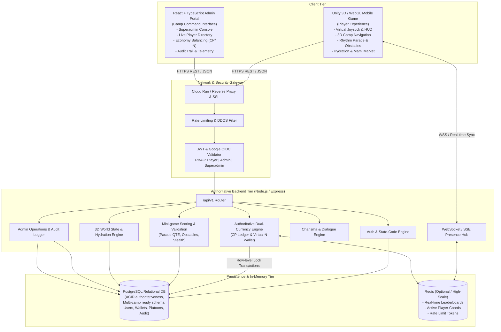
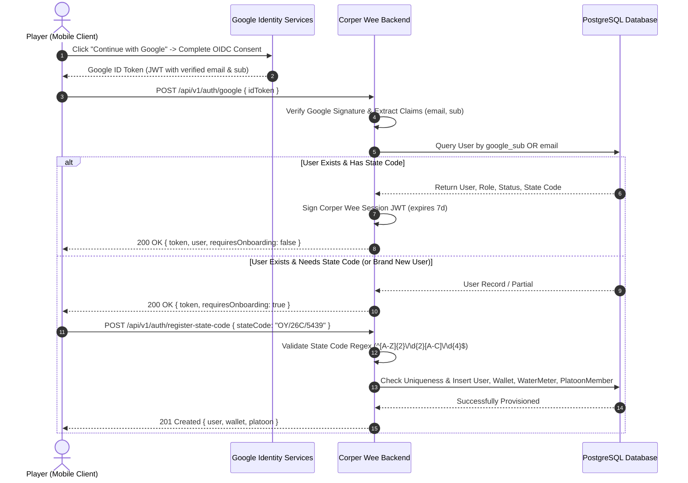
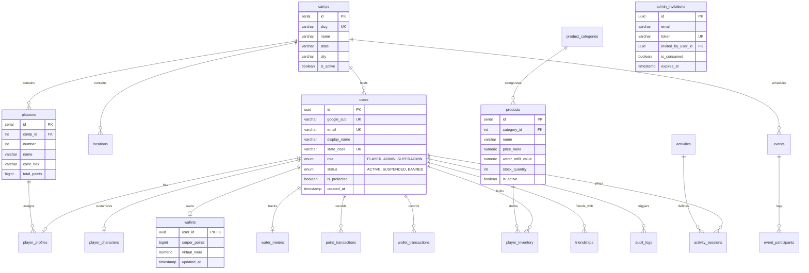

# CORPER WEE: TECHNICAL ARCHITECTURE, DATABASE DESIGN & API CONTRACTS

**Project:** Corper Wee  
**Platform Architecture:** Mobile/Web 3D Simulation Client + Authoritative Express Backend + PostgreSQL Database + Dedicated React Admin Portal  
**Initial Superadmin:** `farlodunolusege@gmail.com` | State Code: `OY/26C/5439` | Role: `SUPERADMIN`  

---

## 1. SYSTEM ARCHITECTURE

### 1.1 Complete End-to-End System Diagram (Mermaid)



---

### 1.2 Authentication & Authorization Flows (Mermaid)



---

### 1.3 Multiplayer Networking & Hosting Options Comparison

| Architecture Pattern | Latency | Server Cost | Implementation Complexity | Authoritativeness | Verdict for Corper Wee MVP |
|---|---|---|---|---|---|
| **A. HTTP Polling / Heartbeat + Authoritative REST (Recommended for MVP)** | 200–500ms | **Lowest** (Scale-to-zero, serverless friendly) | **Low** | **High** (All currency, drills, and purchases server-checked) | **RECOMMENDED FOR MVP.** Perfect for asynchronous camp activities, leaderboards, economy, and NPC corpers without hosting overhead. |
| **B. WebSockets (Socket.io / ws) Presence Cluster** | 50–100ms | **Moderate** (Requires persistent Node instances) | **Moderate** | **High** | **Recommended for Phase 2.** Excellent for real-time player position broadcasts, live chat, and camp bugle broadcast events. |
| **C. WebRTC Mesh / P2P Data Channels** | 20–50ms | **Low Server Cost** (Clients exchange data) | **Very High** (NAT traversal, STUN/TURN, desync) | **Zero** (Vulnerable to cheating and state desync) | **Not Recommended.** Cheating risk is too high for a competitive camp scoring game. |
| **D. Dedicated Game Server (Unity Netcode / Photon / Colyseus)** | 10–30ms | **High** (Continuous GPU/CPU VM allocation) | **High** | **Absolute** | **Future Expansion (Post-MVP)** if full real-time 3D multiplayer physics interactions (like football/volleyball matches) are added. |

**MVP Scaling Limitation:**  
The HTTP + WebSocket hybrid allows scaling to tens of thousands of active corpers because expensive 60fps physics run on the client, while the backend solely handles state checkpointing, transactions, and periodic coordinate heartbeats (5–10Hz).

---

## 2. DATABASE DESIGN (POSTGRESQL)

### 2.1 Entity Relationship Diagram (Mermaid ERD)



---

## 3. API CONTRACTS SPECIFICATION (`/api/v1`)

### 3.1 Module: Authentication & Registration

#### 1. `POST /api/v1/auth/google`
- **Access:** Public
- **Request Body:**
  ```json
  { "idToken": "eyJhbGciOiJSUzI1NiIs..." }
  ```
- **Response (200 OK):**
  ```json
  {
    "status": "success",
    "data": {
      "token": "jwt_session_token",
      "user": {
        "id": "uuid",
        "email": "farlodunolusege@gmail.com",
        "displayName": "Olusege",
        "role": "SUPERADMIN",
        "stateCode": "OY/26C/5439",
        "isProtected": true
      },
      "requiresOnboarding": false
    }
  }
  ```
- **Errors:** 400 Bad Request (missing token), 401 Unauthorized (invalid signature/expired).

#### 2. `POST /api/v1/auth/register-state-code`
- **Access:** Authenticated (New User)
- **Request Body:**
  ```json
  { "stateCode": "OY/26C/5439" }
  ```
- **Validation:** Regex `^[A-Z]{2}\/\d{2}[A-C]\/\d{4}$`
- **Response (201 Created):** User successfully bound to state code, wallet initialized with starter balances.
- **Errors:** 409 Conflict (state code already registered), 422 Unprocessable Entity (malformed code).

---

### 3.2 Module: Player Character & Profile

#### 3. `GET /api/v1/players/me`
- **Access:** Authenticated (`PLAYER`, `ADMIN`, `SUPERADMIN`)
- **Response (200 OK):**
  ```json
  {
    "status": "success",
    "data": {
      "profile": {
        "id": "uuid",
        "displayName": "Olusege",
        "stateCode": "OY/26C/5439",
        "role": "SUPERADMIN",
        "platoon": { "id": 1, "number": 1, "name": "Platoon 1 - Stalwarts", "color": "#16a34a" },
        "level": 3,
        "charisma": 65,
        "paradeRank": "Senior Cadet"
      },
      "character": {
        "gender": "MALE",
        "skinTone": "#8D5524",
        "uniform": "khaki_7_7",
        "hairstyle": "nysc_crest_cap"
      },
      "wallet": {
        "corperPoints": 450,
        "virtualNaira": 2500.00
      },
      "waterMeter": {
        "currentLevel": 88.5
      }
    }
  }
  ```

#### 4. `PUT /api/v1/players/character`
- **Access:** Authenticated
- **Request Body:**
  ```json
  {
    "gender": "MALE",
    "skinTone": "#C68642",
    "hairstyle": "nysc_crest_cap",
    "uniform": "white_pt_kit"
  }
  ```
- **Response (200 OK):** Updated character configuration.

---

### 3.3 Module: Activities & Mini-Games

#### 5. `POST /api/v1/activities/parade/submit`
- **Access:** Authenticated
- **Request Body:**
  ```json
  {
    "sequenceId": "parade_drill_morning_01",
    "results": [
      { "command": "ATTENTION", "responseTimeMs": 210, "isCorrect": true },
      { "command": "QUICK_MARCH", "responseTimeMs": 195, "isCorrect": true },
      { "command": "HALT", "responseTimeMs": 240, "isCorrect": true },
      { "command": "SALUTE", "responseTimeMs": 180, "isCorrect": true }
    ]
  }
  ```
- **Response (200 OK):**
  ```json
  {
    "status": "success",
    "data": {
      "score": 480,
      "accuracy": 98.5,
      "earnedPoints": 150,
      "newCorperPoints": 600,
      "platoonBonusAwarded": 150
    }
  }
  ```

#### 6. `POST /api/v1/activities/canteen-rush/submit`
- **Access:** Authenticated
- **Request Body:**
  ```json
  {
    "timeTakenSeconds": 48.2,
    "obstaclesCleared": 8,
    "puddlesHit": 1,
    "staminaRemaining": 35.0
  }
  ```
- **Response (200 OK):** Authoritative validation of completion, awards CP & canteen discount token.

#### 7. `POST /api/v1/activities/water/deplete`
- **Access:** Authenticated
- **Request Body:**
  ```json
  { "deltaSeconds": 30, "movementIntensity": "RUNNING" }
  ```
- **Response (200 OK):** Returns updated `currentLevel` (e.g. 74.5%).

#### 8. `POST /api/v1/activities/water/consume`
- **Access:** Authenticated
- **Request Body:**
  ```json
  { "productId": 1 }
  ```
- **Response (200 OK):** Deducts water item from inventory and refills hydration to new percentage.

---

### 3.4 Module: Economy & Mami Market

#### 9. `GET /api/v1/market/products`
- **Access:** Authenticated
- **Response (200 OK):** Array of items (Pure Water Sachet, Chilled Bottled Water, Jollof Rice & Chicken, Indomie Noodles, NYSC Custom Vest).

#### 10. `POST /api/v1/market/buy`
- **Access:** Authenticated
- **Request Body:**
  ```json
  { "productId": 2, "quantity": 1 }
  ```
- **Response (200 OK):**
  ```json
  {
    "status": "success",
    "data": {
      "item": { "id": 2, "name": "Cold Bottled Swan Water", "quantity": 1 },
      "wallet": { "virtualNaira": 2300.00 }
    }
  }
  ```
- **Errors:** 400 Bad Request (Insufficient virtual Naira or out of stock).

#### 11. `POST /api/v1/economy/exchange`
- **Access:** Authenticated
- **Request Body:**
  ```json
  { "pointsToConvert": 100 }
  ```
- **Response (200 OK):**
  ```json
  {
    "status": "success",
    "data": {
      "pointsDeducted": 100,
      "nairaCredited": 1000.00,
      "newPoints": 500,
      "newNaira": 3300.00,
      "rateUsed": "10 CP = 100 ₦"
    }
  }
  ```

---

### 3.5 Module: Social & Charisma

#### 12. `POST /api/v1/social/interact`
- **Access:** Authenticated
- **Request Body:**
  ```json
  {
    "targetUserId": "uuid-target",
    "interactionType": "CRACK_CAMP_JOKE"
  }
  ```
- **Response (200 OK):**
  ```json
  {
    "status": "success",
    "data": {
      "outcome": "GREAT_SUCCESS",
      "reaction": "LAUGH_AND_HIGH_FIVE",
      "dialogue": "O boy, you funny die! You be real corper!",
      "charismaGain": 3,
      "friendshipEstablished": true
    }
  }
  ```

---

### 3.6 Module: Admin & Superadmin Operations

#### 13. `GET /api/v1/admin/dashboard`
- **Access:** `ADMIN` or `SUPERADMIN`
- **Response (200 OK):** Aggregate metrics: total registered corpers, active hydration warnings, 24h market revenue, platoon scores.

#### 14. `POST /api/v1/admin/players/:id/suspend`
- **Access:** `ADMIN` or `SUPERADMIN`
- **Validation:** If target user `is_protected == true`, operation is immediately rejected with 403 Forbidden.

#### 15. `POST /api/v1/admin/invitations`
- **Access:** **SUPERADMIN ONLY**
- **Request Body:**
  ```json
  { "email": "commandant@nysc.gov.ng" }
  ```
- **Response (201 Created):** Single-use invitation token created, expires in 48 hours.

#### 16. `GET /api/v1/admin/audit-logs`
- **Access:** **SUPERADMIN ONLY**
- **Response (200 OK):** Complete immutable log of administrative events.
